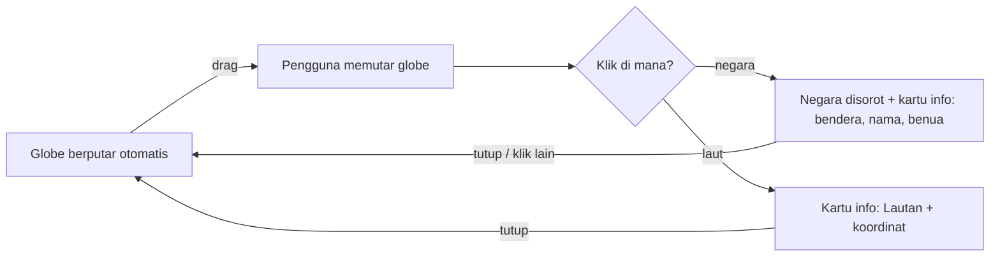

# PRD — Landing Page Interactive Globe

Oct 29, 2026

## Ringkasan

Proyek ini membangun landing page dengan hero section yang memuat globe bumi 3D berukuran besar di tengah. Pengunjung bisa memutar globe, lalu mengklik suatu wilayah untuk melihat nama negara yang diklik dalam kartu info kecil.

Backend memakai Laravel 13 yang sudah di-setup; pekerjaan di PRD ini hanya frontend: navbar desktop, sidebar (drawer) di mobile, dan hero section.

Konteks: tugas mata kuliah pemrograman web framework, dengan syarat wajib Tailwind CSS dan Alpine.js.

## Tujuan & metrik keberhasilan

Tujuan utamanya: hero yang menarik dan interaktif, tapi tetap sederhana dan cepat dimuat.

| Tujuan                 | Metrik                                         | Target                  |
| ---------------------- | ---------------------------------------------- | ----------------------- |
| Hero menarik perhatian | Globe tampil besar, berputar, dan bisa di-drag | Wajib                   |
| Interaksi jelas        | Klik negara memunculkan namanya dalam < 300 ms | Wajib                   |
| Halaman tetap cepat    | Lighthouse Performance (desktop)               | ≥ 85                    |
| Animasi mulus          | Frame rate globe di laptop standar             | ≥ 50 fps                |
| Responsif              | Tampil benar di lebar 360 px – 1920 px         | Tanpa scroll horizontal |
| Memenuhi syarat tugas  | Tailwind + Alpine dipakai untuk UI & state     | Wajib                   |

Target angka di atas adalah usulan; sesuaikan dengan rubrik penilaian dosen.

## Ruang lingkup

Versi 1 hanya mencakup satu halaman (route `/`) dengan tiga komponen UI utama.

**Termasuk (in-scope)**

- Navbar sticky di desktop (≥ 1024 px): logo, menu, tombol CTA.
- Sidebar / drawer di mobile & tablet (< 1024 px): dibuka lewat tombol hamburger, ditutup lewat tombol X, klik overlay, atau tombol Esc.
- Hero section: headline, sub-headline, tombol CTA, dan globe 3D besar di tengah.
- Globe bisa diputar (drag) dan diklik; negara yang diklik disorot dan namanya muncul di kartu info.

**Tidak termasuk (out-of-scope)**

- Game, skor, atau timer.
- Data detail negara dari API luar (cuaca, berita, dsb.).
- Section lain di bawah hero — cukup placeholder.
- Penyimpanan data ke database.

## Tech stack & rekomendasi library

Rekomendasi utama: **globe.gl**, karena sudah menyediakan globe 3D yang bisa diputar plus event klik per negara, jadi kodenya sedikit. Library ini vanilla JS sehingga mudah dipadukan dengan Alpine.

| Lapisan            | Pilihan                                                               | Peran                                  | Catatan                                                       |
| ------------------ | --------------------------------------------------------------------- | -------------------------------------- | ------------------------------------------------------------- |
| Backend            | Laravel 13 + Blade                                                    | Routing, layout, komponen Blade        | Sudah di-setup                                                |
| Build tool         | Vite (bawaan Laravel)                                                 | Bundle CSS/JS, hot reload              | `npm run dev`                                                 |
| Styling            | Tailwind CSS v4                                                       | Layout, responsif, kartu info          | Wajib; pakai `@tailwindcss/vite`                              |
| State UI           | Alpine.js 3                                                           | Toggle sidebar, state negara terpilih  | Wajib                                                         |
| Globe 3D           | [globe.gl](https://github.com/vasturiano/globe.gl) (di atas Three.js) | Render bumi, drag, hover & klik negara | MIT; event `onPolygonClick`, `onPolygonHover`, `onGlobeClick` |
| Data peta          | GeoJSON negara (Natural Earth 110m)                                   | Poligon negara + nama, benua, kode ISO | File statis di `public/data/`                                 |
| Plugin Alpine      | `@alpinejs/focus`                                                     | Focus trap di sidebar                  | Resmi dari Alpine                                             |
| Animasi (opsional) | [GSAP](https://webflow.com/blog/gsap-becomes-free)                    | Animasi masuk headline & globe         | Boleh diganti `x-transition` saja                             |

**Alternatif yang dipertimbangkan**

- **COBE** — globe sangat ringan (~5 kB) dan cantik, tapi tidak bisa klik per negara. Tidak cocok untuk fitur klik.
- **Three.js murni** — paling fleksibel, tapi harus membuat sendiri deteksi klik dan proyeksi koordinat. Terlalu rumit untuk kebutuhan sederhana ini.

## Kebutuhan fungsional

Setiap kebutuhan diberi kode agar mudah dirujuk saat demo atau penilaian.

### Navbar (desktop ≥ 1024 px)

| Kode   | Kebutuhan                                                                                   | Prioritas |
| ------ | ------------------------------------------------------------------------------------------- | --------- |
| NAV-01 | Navbar sticky di atas, transparan saat di hero, berubah blur + latar saat di-scroll > 20 px | Wajib     |
| NAV-02 | Kiri: logo; tengah: menu (Beranda, Jelajahi, Tentang, Kontak); kanan: tombol CTA            | Wajib     |
| NAV-03 | Menu aktif diberi indikator (garis bawah)                                                   | Wajib     |
| NAV-04 | Klik menu = smooth scroll ke section terkait                                                | Wajib     |
| NAV-05 | Toggle dark/light mode, tersimpan di `localStorage`                                         | Opsional  |

### Sidebar / drawer (mobile & tablet < 1024 px)

| Kode   | Kebutuhan                                                                      | Prioritas |
| ------ | ------------------------------------------------------------------------------ | --------- |
| SID-01 | Menu desktop disembunyikan, diganti tombol hamburger di kanan atas             | Wajib     |
| SID-02 | Drawer meluncur dari kiri, lebar 80% layar (maks 320 px), dengan overlay gelap | Wajib     |
| SID-03 | Tutup dengan tombol X, klik overlay, tombol Esc, atau klik salah satu menu     | Wajib     |
| SID-04 | Scroll body dikunci saat drawer terbuka                                        | Wajib     |
| SID-05 | Focus trap di dalam drawer (`x-trap` dari `@alpinejs/focus`)                   | Wajib     |
| SID-06 | Tombol hamburger punya `aria-expanded` & `aria-controls`                       | Wajib     |
| SID-07 | Transisi masuk/keluar 200–300 ms memakai `x-transition`                        | Wajib     |

### Hero section & globe

| Kode   | Kebutuhan                                                                                            | Prioritas |
| ------ | ---------------------------------------------------------------------------------------------------- | --------- |
| HER-01 | Tinggi minimal 100vh (pakai `min-h-svh` agar aman di mobile)                                         | Wajib     |
| HER-02 | Globe di tengah: ±600 px di desktop, ±90vw di mobile                                                 | Wajib     |
| HER-03 | Headline + sub-headline + tombol CTA di sekitar globe                                                | Wajib     |
| HER-04 | Globe berputar otomatis pelan; berhenti saat pengguna drag, lanjut lagi setelah 3 detik diam         | Wajib     |
| HER-05 | Globe bisa diputar dengan drag (mouse & sentuh); zoom dimatikan agar tidak mengganggu scroll halaman | Wajib     |
| HER-06 | Hover negara (desktop): negara sedikit terangkat/berubah warna, kursor jadi pointer                  | Wajib     |
| HER-07 | Klik negara: negara disorot, kartu info muncul berisi bendera, nama negara, dan benua                | Wajib     |
| HER-08 | Klik laut / area kosong: kartu menampilkan "Lautan" + koordinat lat/lng                              | Opsional  |
| HER-09 | Kartu info bisa ditutup (tombol X atau klik negara lain untuk mengganti)                             | Wajib     |
| HER-10 | Latar luar angkasa (bintang) + efek atmosfer biru di tepi globe                                      | Opsional  |
| HER-11 | Loading state selama tekstur & GeoJSON dimuat                                                        | Wajib     |

## Alur interaksi globe

Interaksinya hanya tiga langkah: putar, klik, lihat nama negara.



**Pembagian tanggung jawab kode**

- **Alpine** (`x-data="globeHero"`) memegang state: `selected` (negara terpilih atau `null`) dan `loading`. Kartu info dirender oleh Alpine + Tailwind sebagai overlay HTML di atas canvas, muncul dengan `x-show` + `x-transition`.
- **globe.gl** mengurus visual & event: render, warna poligon (negara terpilih diberi warna berbeda), lalu memanggil method Alpine saat negara diklik.
- **Data negara** diambil dari properti GeoJSON (`NAME`, `CONTINENT`, `ISO_A2`). Bendera dibuat dari kode ISO menjadi emoji, jadi tidak perlu file gambar.

**Posisi kartu info**

- Desktop: kartu kecil di pojok kanan bawah hero.
- Mobile: kartu di bawah globe, lebar penuh.

## Kebutuhan non-fungsional

Globe 3D adalah bagian terberat halaman, jadi sebagian besar aturan di bawah ini menjaga agar globe tidak memperlambat halaman.

| Area          | Kebutuhan                                                                               |
| ------------- | --------------------------------------------------------------------------------------- |
| Performa      | globe.gl di-load lewat dynamic `import()` setelah halaman tampil, bukan di bundle utama |
| Performa      | Tekstur bumi ≤ 500 kB (WebP/JPG 2048 px); GeoJSON 110m (±250 kB)                        |
| Performa      | Rendering dijeda (`pauseAnimation()`) saat hero keluar viewport atau tab tidak aktif    |
| Performa      | `pixelRatio` dibatasi maks 2 agar ringan di HP                                          |
| Responsif     | Ukuran globe dihitung ulang saat `resize`                                               |
| Aksesibilitas | Navigasi keyboard penuh untuk navbar & drawer; kontras teks ≥ 4.5:1                     |
| Aksesibilitas | `prefers-reduced-motion`: auto-rotate dimatikan                                         |
| Aksesibilitas | Kartu info memakai `aria-live="polite"` agar nama negara dibacakan screen reader        |
| Fallback      | Jika WebGL tidak didukung, tampilkan gambar globe statis + pesan                        |
| Browser       | Chrome, Edge, Firefox, Safari terbaru; Android Chrome & iOS Safari                      |

## Struktur file & arsitektur komponen

Semua UI dipecah jadi komponen Blade, sementara logika globe berada di modul JS terpisah yang didaftarkan ke Alpine.

**Instalasi paket**

```bash
npm install alpinejs @alpinejs/focus globe.gl
npm install -D tailwindcss @tailwindcss/vite
# opsional: npm install gsap
```

**Struktur folder**

```text
resources/
├── css/
│   └── app.css                 # @import "tailwindcss"; + @theme (warna, font)
├── js/
│   ├── app.js                  # boot Alpine + plugin, daftarkan komponen
│   ├── components/
│   │   ├── navbar.js           # Alpine.data('navbar'): open, scrolled, toggle()
│   │   └── globe-hero.js       # Alpine.data('globeHero'): selected, loading
│   └── globe/
│       └── createGlobe.js      # inisialisasi globe.gl (dynamic import)
└── views/
    ├── layouts/app.blade.php   # <head>, @vite, slot
    ├── components/
    │   ├── navbar.blade.php
    │   ├── sidebar.blade.php
    │   ├── hero.blade.php
    │   └── country-card.blade.php  # kartu info negara
    └── welcome.blade.php       # <x-navbar/> <x-sidebar/> <x-hero/>
public/
├── textures/earth-day.webp
└── data/countries-110m.geojson
```

**Contoh kerangka Alpine untuk globe**

```js
// resources/js/components/globe-hero.js
const flag = (iso) =>
    iso && iso.length === 2
        ? String.fromCodePoint(
              ...[...iso.toUpperCase()].map((c) => 127397 + c.charCodeAt()),
          )
        : "🏳️";

export default () => ({
    selected: null,
    loading: true,
    async init() {
        const { createGlobe } = await import("../globe/createGlobe.js");
        this.globe = await createGlobe(this.$refs.canvas, {
            onCountryClick: (p) => {
                this.selected = {
                    name: p.NAME,
                    continent: p.CONTINENT,
                    flag: flag(p.ISO_A2),
                };
            },
            onOceanClick: ({ lat, lng }) => {
                this.selected = {
                    name: "Lautan",
                    continent: `${lat.toFixed(2)}, ${lng.toFixed(2)}`,
                    flag: "🌊",
                };
            },
        });
        this.loading = false;
    },
    close() {
        this.selected = null;
    },
});
```

```html
<!-- resources/views/components/country-card.blade.php -->
<div
    x-show="selected"
    x-transition
    aria-live="polite"
    class="absolute bottom-6 right-6 rounded-2xl bg-white/10 backdrop-blur p-4 text-white shadow-lg"
>
    <button @click="close()" class="absolute top-2 right-2" aria-label="Tutup">
        ✕
    </button>
    <p class="text-3xl" x-text="selected?.flag"></p>
    <p class="text-lg font-semibold" x-text="selected?.name"></p>
    <p class="text-sm text-white/70" x-text="selected?.continent"></p>
</div>
```

Navbar dan sidebar berbagi satu state `open` lewat `Alpine.store('ui')` agar tombol hamburger di navbar bisa membuka drawer di komponen lain.

## Milestone, acceptance criteria & risiko

Pekerjaan dibagi 4 tahap berurutan. Tanggal belum ditentukan — isi sesuai deadline tugas.

1. **Setup frontend** — Tailwind v4 + Alpine terpasang, layout Blade jalan, `npm run dev` tanpa error.
2. **Navbar & sidebar** — NAV-01 s.d. NAV-04 dan SID-01 s.d. SID-07 lolos dicek di lebar 360, 768, dan 1440 px.
3. **Hero + globe** — globe tampil besar, berputar, bisa di-drag, klik negara memunculkan kartu info.
4. **Polishing & uji** — Lighthouse Performance ≥ 85, cek `prefers-reduced-motion`, uji di 1 HP dan 1 laptop.

**Checklist demo**

- [ ] Drawer mobile terbuka/tertutup dengan 4 cara (X, overlay, Esc, klik menu)
- [ ] Globe berputar otomatis dan bisa di-drag dengan mouse maupun jari
- [ ] Klik negara memunculkan bendera, nama, dan benua yang benar
- [ ] Negara yang diklik tersorot warnanya
- [ ] Kartu info bisa ditutup
- [ ] Tidak ada scroll horizontal di 360 px

**Risiko & mitigasi**

| Risiko                                     | Dampak                                         | Mitigasi                                                                               |
| ------------------------------------------ | ---------------------------------------------- | -------------------------------------------------------------------------------------- |
| Globe berat di HP kelas bawah              | Lag                                            | Batasi `pixelRatio`, pakai GeoJSON 110m, jeda render di luar viewport                  |
| Negara kecil sulit diklik                  | Pengguna salah klik                            | Tampilkan nama saat hover (desktop); peta 110m memang tidak memuat negara sangat kecil |
| Drag globe bentrok dengan scroll di mobile | Halaman sulit di-scroll                        | Matikan zoom; batasi area drag pada canvas globe saja                                  |
| Nama negara dalam bahasa Inggris           | Kurang konsisten dengan UI berbahasa Indonesia | Pakai properti `NAME_ID` dari Natural Earth bila tersedia, fallback ke `NAME`          |
